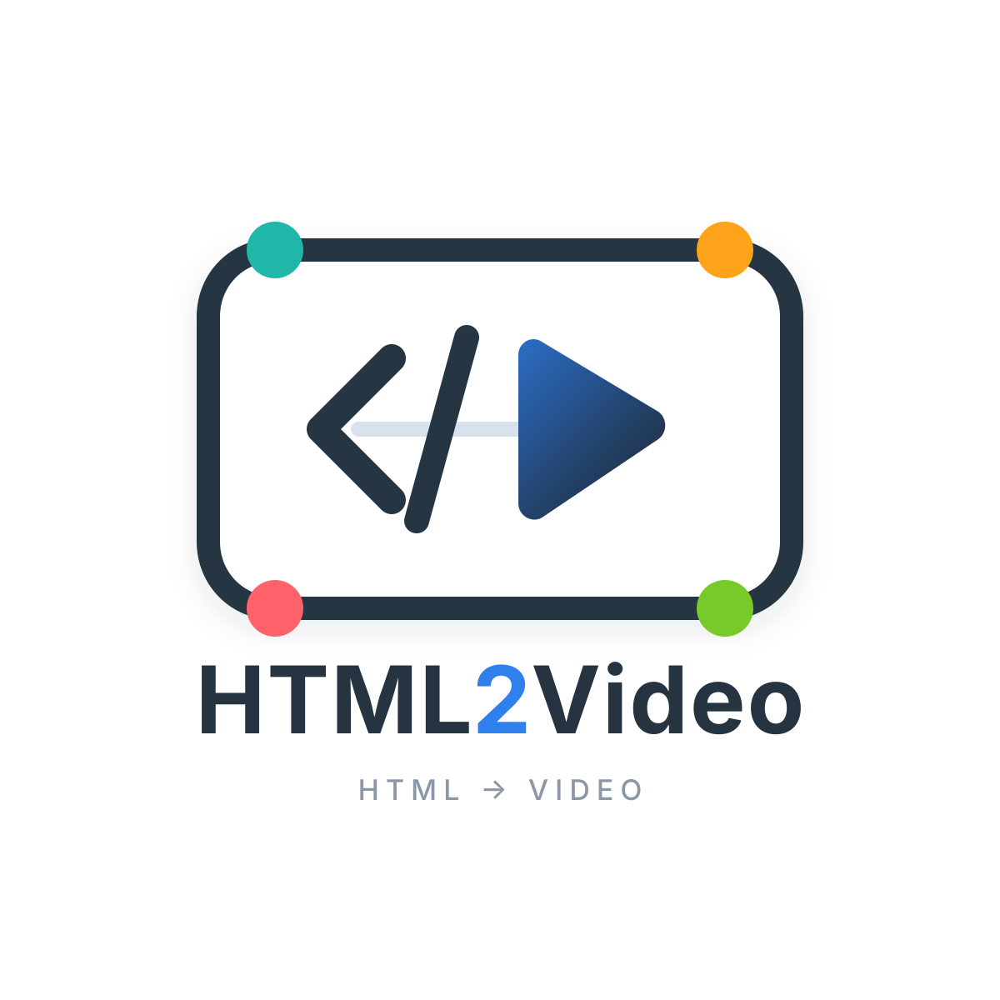

# HTML TTS Video

[All tools](../README.md)



Create narrated explainers, software tutorials, and source-led reports from `scenes.json`, `body.html`, and optional local media. Studio provides project management, source/media editing, captions, voice previews, TTS, and MP4 rendering. Projects support landscape (`16:9`) and portrait (`9:16`) formats.


## Contents

- [Requirements](#requirements)
- [Quick start](#quick-start)
- [Studio and hosting](#studio-and-hosting)
- [TTS providers](#tts-providers)
- [Project files and source format](#project-files-and-source-format)
- [Edit source and media](#edit-source-and-media)
- [Agent and Web AI workflows](#agent-and-web-ai-workflows)
- [Agent production with real materials](#agent-production-with-real-materials)
- [Generate a Web AI prompt](#generate-a-web-ai-prompt)
- [Architecture](#architecture)
- [Checks and diagnostics](#checks-and-diagnostics)

## Requirements

- Use Python 3.11 in a dedicated virtual environment.
- Node.js must be available on `PATH` for the JavaScript syntax checks in `python main.py check`.
- Installation needs network access for Python dependencies and the managed Chromium Headless Shell; TTS needs access to the selected speech service.
- Edge TTS is the default provider and needs no API credentials. Azure Speech requires server-side environment configuration.
- Browser automation uses Python Playwright's managed Chromium Headless Shell. Media processing uses the FFmpeg binary supplied by `imageio-ffmpeg`.

## Quick start

From the `misc-tools` root:

```bash
cd html-edge-tts-video
python3.11 -m venv .venv
source .venv/bin/activate
python main.py install
python main.py studio
```

Open `http://127.0.0.1:8765/`. All later commands in this README run from `html-edge-tts-video/` with the virtual environment activated, except `studio.sh`, which selects `.venv/bin/python` itself.

`install` installs the Python dependencies and only Playwright's Chromium Headless Shell. The browser store, recordings, profiles, screenshots, traces, and temporary files stay under `.local/playwright/`. It does not create the virtual environment. Use this entry point for dependency installation rather than installing a separate browser or system FFmpeg.

Studio can create or import a project and preview it before narration is generated. Press `Ctrl+C` to stop the foreground server. To try the command-line workflow, create a copy of the read-only starter:

```bash
python main.py init --target .local/work/my-video
python main.py check --source .local/work/my-video
```

For a portrait project, choose the orientation at creation time:

```bash
python main.py init --target .local/work/my-portrait-video --aspect-ratio 9:16
```

For a narrated final MP4, generate TTS first and keep the source explicit when rendering:

```bash
python main.py tts --source .local/work/my-video
python main.py render --source .local/work/my-video --size 720p --output my-video.mp4
```

The rendered file is `.local/work/my-video/output/my-video.mp4`. `--output` accepts a filename, not
a path; renders always stay inside the selected project's `output/` directory.

Studio's build panel lets you choose the project's TTS voice before generating narration. For
renders it suggests a project-based sequence such as `my-video-01.mp4`, then advances to
`my-video-02.mp4` when the earlier output already exists; the suggested filename remains editable.

The starter uses illustrative diagrams and runtime code. For source-led reporting, acquire the actual evidence using [Agent production](docs/agent-production.md).

## Studio and hosting

### Background process

To run Studio in the background using the project `.venv`:

```bash
./studio.sh start
./studio.sh status
./studio.sh logs
./studio.sh stop
```

The script defaults to host `0.0.0.0`, port `10071`, and URL prefix `/html2video`:
open `http://<server-ip>:10071/html2video/`. These defaults differ from the foreground CLI's
`127.0.0.1:8765/`. For the domain root, use `./studio.sh start --base-path /`.

To choose a different prefix for a reverse proxy:

```bash
./studio.sh start --host 127.0.0.1 --base-path /xxx
./studio.sh restart --host 127.0.0.1 --base-path /xxx
```

`restart` uses the supplied options or the defaults, so repeat custom settings.
Logs and the PID are stored in `.local/studio/`; each start replaces the log.
The script works from any working directory and does not enable boot-time startup.
When using this script, point the reverse proxy at port `10071`.

### Foreground CLI and reverse proxy

The foreground CLI runs at the domain root by default. To mount it under a URL prefix:

```bash
python main.py studio --base-path /xxx
```

Open `http://127.0.0.1:8765/xxx/`. The prefix applies to pages, APIs, previews, audio,
media, and output links. `/xxx` redirects to `/xxx/`; nested prefixes such as
`/tools/video` are supported. Omit `--base-path` to keep the existing root URLs.
This is a server setting; project source files and manifests do not change.

For an Nginx reverse proxy, preserve the prefix when forwarding requests (no trailing
slash on `proxy_pass`). This example uses the foreground CLI on port `8765`; use `10071` for the background script:

```nginx
location = /xxx {
    return 308 /xxx/$is_args$args;
}
location /xxx/ {
    proxy_pass http://127.0.0.1:8765;
    proxy_set_header Host $host;
    client_max_body_size 150m;
}
```

### Project management

Studio creates, imports, deletes, validates, plays, narrates, and renders projects. “New project”
first offers AI creation or result import; neither path creates a folder until “Save and activate” is
used in the import dialog. Saving validates both source files, creates one eight-character Studio
project directory, writes its manifest, and activates it in one operation. Prompt creation and
source import open as dialogs without leaving the workspace.

The Studio, source editor, caption editor and voice page follow the browser's system light/dark
preference automatically. This affects editor chrome, not the authored video's palette. Project
switches use a modal loading mask until the project data and its matching preview are ready;
duplicate switches and editing shortcuts are blocked while loading. Failed switches release the
mask with an error, and a caption project without a timeline clears the previous project's editor.

A project manifest stores identity, display name, the single Studio `active` selection, immutable
`aspectRatio`, language, and TTS settings. Studio asks for 16:9 or 9:16 before prompt generation or
import, defaults to 16:9, and disables that choice when an existing project is edited. Resolution
presets automatically swap width and height for portrait renders. The starter manifest is generated
locally with `active: true` and `aspectRatio: "16:9"` on first use and is
not tracked by Git. Selecting a project only updates manifest state. Agent-created kebab-case
project folders keep their directory names when Studio discovers them. Presentation style and
rendering engine remain properties of `body.html`. The built-in `starter` project is read-only and
cannot be deleted through Studio.

Voice previews are independent of project selection and live under `.local/voice-preview/`.

## TTS providers

Edge TTS works without credentials and is the default Studio provider. Azure Speech is optional;
configure it in the environment that starts the CLI or Studio. Credentials stay server-side and
are never written to a project manifest or sent to the browser.

```bash
export AZURE_SPEECH_KEY="your-speech-resource-key"
export AZURE_SPEECH_ENDPOINT="https://your-resource.cognitiveservices.azure.com/"
```

When placing these values in `~/.bashrc`, keep the `export` keyword. A plain assignment can be
printed by `echo` in the shell but is not inherited by the Python process that runs Studio.

The CLI defaults to `--provider edge`. It uses Azure only when the user or calling agent explicitly
passes `--provider azure`; missing Azure configuration then produces an error rather than a silent
fallback. Studio shows both choices and marks Azure unavailable when it is not configured.

For Azure through the CLI:

```bash
python main.py tts --source .local/work/my-video --provider azure
```

## Project files and source format

```text
.local/work/my-video/
  scenes.json       # Authored scene order, labels, and narration
  body.html         # Authored visuals and optional deterministic JavaScript
  manifest.json     # Created locally for project identity and settings
  production.json   # Required for complete Agent videos; optional for Web AI/legacy projects
  media/            # Optional project-local source media
  captions.json     # Optional manual caption timing overrides
  generated/        # Timeline and narration cache
  output/           # Rendered videos
```

`scenes.json` owns scene order, chapter labels, and stable narration segments. `body.html` owns every visible title,
layout, color, diagram, chart, and optional deterministic visual module. The stable shell owns TTS
timing, captions, playback, chapter progress, scene transitions, and MP4 rendering.
The Source and Caption editors modify the same narration segments in `scenes.json`; caption timing
is derived separately from audio and never becomes a second text source. Studio accepts simple
narration strings only as an import/save submission format, then normalizes them into scene-scoped
segments before writing. Saved projects and command-line builds accept only the canonical segment
schema. This normalization does not run TTS.
Each manifest fixes `aspectRatio` to `16:9` (default landscape) or `9:16` (portrait) when the
project is created. Create a new project to change orientation.

`scenes.json` uses the canonical narration-segment schema:

```json
[
  {
    "id": "intro",
    "category": "总览",
    "narration": {
      "segments": [
        { "id": "intro-01", "text": "这项技术正在改变产品从概念到交付的路径。" }
      ]
    }
  },
  {
    "id": "outro",
    "category": "收尾",
    "narration": {
      "segments": [
        { "id": "outro-01", "text": "最终差异集中在交付物、协作方式和持续维护成本。" }
      ]
    }
  }
]
```

The first id must be `intro`, with a direct topic introduction. The last id must be `outro`, with a brief conclusion. A greeting or sign-off is optional; use one when the requested style calls for it. Landscape categories must
stay within 12 CJK characters or about 24 Latin characters. The shell omits scene numbers, keeps
boundary dots proportional to narration time, and centers each independently autofitted category
between its two dots. Labels use at most two lines. Portrait categories still use 2-3 CJK characters or one English word of at most 8
letters so the compact chapter rail remains readable.
Add a matching section and all project CSS to `body.html`:

```html
<!DOCTYPE html>
<html>
  <head>
    <meta charset="utf-8" />
    <meta name="viewport" content="width=device-width, initial-scale=1" />
    <title>Presentation video</title>
    <style>
      .slide {
        position: absolute;
        inset: 0;
        padding: 8vh 7vw 22vh;
      }
    </style>
  </head>
  <body>
    <section class="content-scene slide" data-scene="intro">
      <h1>标题</h1>
    </section>
    <section class="content-scene slide" data-scene="outro">
      <h2>总结</h2>
    </section>
  </body>
</html>
```

Do not hard-code `active` or `is-active` on a scene. The shell selects exactly one scene from the
timeline and owns scene visibility. Scope source CSS to `#stage` and scene elements; global `html`
or `body` rules can interfere with the shell and are not supported.

Do not add playback controls, captions, footers, timecodes, chapter rails, or scene transitions.
Prefer HTML/CSS/SVG. An advanced visual may use one inline module exporting deterministic `mount()`
and `renderAtTime()` functions; see the [Agent workflow](docs/agent-skill.md).

## Edit source and media

With the foreground defaults, open `http://127.0.0.1:8765/source` while Studio is running to edit an existing project's
`scenes.json` and `body.html`. When using a custom host, port, or prefix, open the Source Editor from Studio to use the matching URL. Saving validates both files and reloads the stable-shell preview.
Visual-only, category, and media changes preserve generated narration, timeline, and captions.
Changing scene ids, order, or narration invalidates those generated assets so they cannot drift
from the source.

The scene strip above the preview switches scenes through the stable shell; authored HTML must not
implement keyboard shortcuts or its own scene-navigation events. Web AI output uses
Studio-editable top-level objects with stable
`data-studio-id` values and fixed-canvas `left`, `top`, `width`, and `height` geometry. Those objects
can be selected, dragged, resized, edited as text, or deleted in the preview. A top-level group may
still use Grid, Flexbox, or SVG internally, so only composition blocks—not every diagram
primitive—need absolute positioning.

The Source Editor also manages the project's optional `media/` directory. It supports file upload,
drag and drop, pasted images, replacement, deletion, and copyable project-relative paths.
References such as `media/hero.webp` or `media/demo.mp4` are scanned from `body.html`; missing files
appear as slots that can be filled without editing the HTML again. Uploaded images and videos can
also be inserted directly into the selected scene as editable objects. Media remains in the
selected project rather than a global asset workspace.

During rendering, project videos are muted and synchronized to scene-relative time. Frame capture
waits for deterministic video seeking before taking each screenshot; narration remains the final
audio track.
Optional `data-media-in`, `data-media-out`, `data-media-start`, and `data-media-rate` attributes
select a source interval and its scene-relative playback window. Cue-linked shot groups use
`data-shot-cues` to follow narration timing. See [Agent production](docs/agent-production.md) for
examples and defaults; existing media work without either feature.

## Agent and Web AI workflows

Short technology and AI news scripts also use the project skill
[`write-tech-narration`](.agents/skills/write-tech-narration/SKILL.md). It covers fact selection,
spoken explanations, source visuals, and editing out empty commentary. It can be requested with
`$write-tech-narration` for drafting or revising a script without starting TTS or video rendering.

[Agent workflow](docs/agent-skill.md) and [Web AI source prompt](docs/source-prompt.md) share the same source contract and visual
principles, but they address different participants and stop at different delivery boundaries:

- `docs/agent-skill.md` is the local code agent's operating guide. The agent owns the project
  lifecycle: choose a project folder and immutable aspect ratio, acquire useful materials,
  design shots and narration together, author or import the source, validate it, generate real
  TTS and timing, preview when useful, and render the final MP4. It also
  owns the repository's browser, FFmpeg, generated-file, and output-directory constraints.
- `docs/source-prompt.md` is a template for an external browser-based AI. That AI owns source
  generation only and must return exactly two complete fenced code blocks: `scenes.json` and
  `body.html`. It does not create or select projects, write `manifest.json`, run commands, generate
  TTS, edit timeline data, operate the stable shell, or render video.

The code agent is responsible for the project and final video; Web AI produces two importable
source files. The stable shell remains the sole owner of timing,
captions, chapter progress, playback, and transitions in both workflows.

Code agents therefore start with [SKILL.md](SKILL.md) and follow [docs/agent-skill.md](docs/agent-skill.md) directly. They should invoke
`python main.py prompt` only when the user wants a prompt to paste into an external Web AI, not as a
prerequisite for authoring source locally.

### Production loop

```bash
python main.py check --source .local/work/my-video
python main.py tts --source .local/work/my-video
python main.py studio --source .local/work/my-video
python main.py render --source .local/work/my-video --output video.mp4
```

For complete Agent production, add `--production` to the check command above.

Use `python main.py captions --source .local/work/my-video` to start the caption-editing server after TTS, then open `http://127.0.0.1:8765/captions`. Studio-managed projects keep generated audio and output beside their two source files.
The only tracked files under `.local/` are `.local/work/starter/body.html` and `scenes.json`; every other file
under `.local/` is runtime state. Never author a video in `starter`; each video belongs in its own
`.local/work/my-video/` folder.

Transitions default to a deterministic 0.4-second dip to the shell background. Set
`--transition 0.3`, or use `--transition 0` to disable them.

## Agent production with real materials

For news and factual product/repository coverage, the Agent starts with useful source evidence:
the relevant excerpt, original chart, actual demo, or authorized capture. A headline establishes
who announced something; a demo shows what the product did. Mechanism explainers can instead use
authored diagrams that visibly explain cause and effect. Chapters can contain several shots,
and asset count follows the claims being explained rather than a fixed quota.

Complete new Agent videos keep a project-local `production.json` that connects assets and their
sources/reuse basis to scene ids, narration cue ids, and concrete visible details. It does not
change the `scenes.json` or manifest schema, and does not drive cuts automatically. Web AI keeps
its two-code-block output; existing projects remain compatible without a production plan.

Lightweight media commands support this work when network and browser use are authorized:

```bash
python main.py media fetch --source .local/work/my-video --url '<asset-url>' --name demo.gif
python main.py media capture --source .local/work/my-video --url '<page-url>' --name article.png --selector '<css>'
python main.py media clip --source .local/work/my-video --input media/demo.gif --name demo.mp4 --start 2 --duration 6
python main.py check --source .local/work/my-video --production
```

These commands use the managed browser and FFmpeg, preserve local media, and do not grant network
permission themselves. Run the production check before TTS and after changing shots, narration,
or assets; TTS/render recheck an existing plan. Path, reference, and cue coverage checks do not
prove source authenticity, readability, timing, or editorial quality. The Agent still inspects
the implemented shots at the relevant narration moments. See [Agent production](docs/agent-production.md)
for the plan format, media commands, and shot implementation.

## Generate a Web AI prompt

```bash
python main.py prompt --topic "介绍一个新产品" --language zh-CN
python main.py prompt --topic "Explain event loops" --language en-US
```

The single template is [docs/source-prompt.md](docs/source-prompt.md). It keeps the visual language consistently bright,
editorial, and blue-green while allowing the AI to choose a fitting composition for each subject.
Studio and the prompt CLI generate one Web AI delivery form for copying into a browser-based AI.
Code agents follow `SKILL.md` and `docs/agent-skill.md` directly instead of generating a prompt.

## Architecture

```text
scenes.json + body.html
  -> direct project source
  -> Edge TTS or Azure Speech narration-derived composition timeline
  -> <project>/generated/
  -> pipeline/shell/runtime.js
  -> Playwright Chromium Headless Shell
  -> imageio-ffmpeg
  -> <project>/output/*.mp4
```

The authored source owns content and presentation styling. The stable shell owns captions, chapter
progress, playback, timing, and transitions. Generated audio and timelines are caches rather than
source. Studio adds project metadata and editing UI without changing the two-file contract.

### Source loading and validation

[pipeline/factory.py](pipeline/factory.py) resolves `scenes.json`, `body.html`, optional `media/`, optional
`captions.json`, project-local `generated/`, and project-local `output/`. It does not copy source into
a global current workspace. The shell receives an explicit project base URL for Studio previews and
Playwright renders.

[pipeline/validate_sources.py](pipeline/validate_sources.py) checks scene ids, the required `intro` and `outro` boundary scenes,
short categories, narration, matching `[data-scene]` sections, embedded CSS, and the absence of
transport UI. Source may contain at most one inline module script. It must export `mount()` and
`renderAtTime()`, avoid an independent animation loop, and pin Three.js versions.

Sidecar `body.css`, `visual.js`, nested `content/`, and `index.html` paths are not supported.

### Prompt, timeline, and rendering

`pipeline/prompt_composer.py` fills `docs/source-prompt.md` with the requested content parameters.
Agents write the source directly and maintain the production plan for complete new videos;
Web AI returns two fenced code blocks. The prompt keeps a
consistent bright blue-green editorial palette while allowing scene composition to follow the topic.

`pipeline/build_tts.py` synthesizes scenes, captures WordBoundary metadata, inserts scene gaps, and
concatenates narration using managed FFmpeg. `pipeline/build_offline_preview.py` produces isolated
debug assets with estimated durations and silent audio; it never replaces a real TTS build. The
shell normally estimates preview timing in memory when current narration assets are unavailable.

`pipeline/shell/runtime.js` loads source, activates scenes by absolute time, applies captions,
updates chapter progress, and calculates transitions. It exposes:

```js
window.compositionReady;
window.getCompositionDuration();
window.renderAtTime(seconds);
window.renderSceneAtCue(sceneId, cueId);
window.getPlaybackState();
window.togglePlayback();
window.startCompositionPlayback();
```

`pipeline/render_video.py` captures with Python Playwright's managed Chromium Headless Shell and
muxes with the FFmpeg binary returned by `imageio-ffmpeg`. It never uses a system browser or FFmpeg
from `PATH`.

## Checks and diagnostics

| Command | Purpose | Resource use |
| --- | --- | --- |
| `python main.py check` | Validate starter, shell contracts, JavaScript syntax, and Python compilation | Static checks |
| `python main.py check --source .local/work/my-video` | Validate a selected project and shell contracts | Static checks |
| `python main.py check --source .local/work/my-video --production` | Also require and validate `production.json` | Static checks |
| `python main.py doctor` | Verify managed Chromium, FFmpeg, and browser-cache placement | Launches the managed browser |
| `python main.py smoke` | Load the active composition in headless Chromium | Starts a temporary Studio server and browser |

`check --production` validates the structure of the production plan; the Agent still needs to review source authenticity, readability, and editorial quality. Use `doctor` and `smoke` when browser automation and a temporary server are appropriate for the environment.

Studio previews and scrubs an estimated in-memory timeline automatically before TTS. The legacy
`offline` command is only a debug aid and writes isolated assets under `generated/preview/`:

```bash
python main.py offline --source .local/work/my-video
```

`offline` produces silent audio, not final narration. Run real TTS before rendering a narrated final video.
