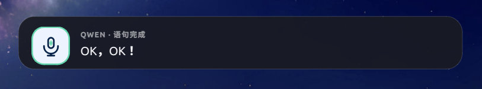

# Qwen ASR Input

[All tools](../README.md)

A small, focused cloud speech input tool for Linux. Hold `Ctrl+Win` to record,
release either key to stop recording immediately, and release both keys to insert
the Qwen ASR result at the input position that was active before recording.

While recording, a Qt overlay with a microphone icon appears at the bottom center
of the screen. It updates the recognized text in real time as the server emits
`result-generated` events, briefly displays the final result, and then closes
automatically.



## Contents

- [Requirements](#requirements)
- [Quick start](#quick-start)
- [Background operation and diagnostics](#background-operation-and-diagnostics)
- [Configuration](#configuration)
- [Design and project structure](#design-and-project-structure)
- [Limitations](#limitations)

## Requirements

- **Python 3.11 or newer** as `python3`; the launcher creates its virtual environment with this interpreter.
- An Ubuntu desktop using **X11**, a microphone, and access to keyboard devices under `/dev/input/event*`.
- `arecord`, `xclip`, PyQt5 through `/usr/bin/python3`, and the X11/XTEST libraries.
- A DashScope API key supplied through `ALIYUN_ASR_API_KEY` and network access to the configured Qwen endpoint.

Only Ubuntu X11 has been tested. Wayland is not supported; other Linux distributions have not been tested. Check the session type with:

```bash
echo "$XDG_SESSION_TYPE"  # Expected output: x11
python3 --version        # Must be 3.11 or newer
```

Install the system dependencies on Ubuntu:

```bash
sudo apt update
sudo apt install python3 python3-venv alsa-utils xclip python3-pyqt5 libx11-6 libxtst6
```

The `python3` package version depends on the Ubuntu release; ensure the interpreter meets the requirement above.

If the current user is not in the `input` group, grant keyboard-device access:

```bash
sudo usermod -aG input "$USER"
```

Log out and back in for the new group membership to take effect. Do not run the entire application as root.

## Quick start

From the `misc-tools` root, enter this project directory. All later commands in this README run from `qwen-asr-input/`. The launcher automatically creates `.venv` and installs missing Python dependencies from [requirements.txt](requirements.txt):

```bash
cd qwen-asr-input
cp config.example.toml config.toml
export ALIYUN_ASR_API_KEY='your DashScope API key'
./qwen-asr-input check
./qwen-asr-input run
```

The `run` command starts the application in the foreground and is recommended for
the first launch and troubleshooting. After `ready — hold Ctrl+Win to record`
appears, focus any input field, hold `Ctrl+Win`, and speak. Releasing either key
stops recording; the recognized text is inserted after both keys are released.
Press `Ctrl+C` to exit.

The dependency check itself makes no ASR request. On a fresh environment, the launcher may first download Python dependencies. The check reports whether the API key is set, but does not validate it against the cloud service.

## Background operation and diagnostics

After confirming that foreground mode works, start the background service:

```bash
export ALIYUN_ASR_API_KEY='your DashScope API key'
./qwen-asr-input start
./qwen-asr-input status
```

Use the following commands to manage it:

```bash
./qwen-asr-input logs       # Follow logs; Ctrl+C only exits the log viewer
./qwen-asr-input restart    # Restart the service
./qwen-asr-input stop       # Stop the service
```

The PID file and logs are stored in `.runtime/` within the repository. The project
does not configure automatic startup at login. If you add it yourself, ensure that
the login environment provides `ALIYUN_ASR_API_KEY`, `DISPLAY`, and `XAUTHORITY`.

Use the repository launcher for environment setup and process management. It supports:

| Command | Purpose |
| --- | --- |
| `run [OPTIONS]` | Run in the foreground |
| `start [OPTIONS]` | Start in the background |
| `status` | Show process status and resource usage |
| `logs` | Follow the background log |
| `stop` | Stop the background process |
| `restart [OPTIONS]` | Restart the background process |
| `check` | Check local components |

Place Python options after `run` or `start`.

To test text injection without recording or contacting Qwen, run the following
command and switch to the target input field within three seconds:

```bash
./qwen-asr-input run --inject-test 'Qwen input test succeeded'
```

## Configuration

Copy [config.example.toml](config.example.toml) to `config.toml`. The launcher resolves this file relative to its own directory, including when invoked from elsewhere. Override it with `--config` or `QWEN_ASR_INPUT_CONFIG`:

```bash
./qwen-asr-input run --config /absolute/path/to/config.toml --debug
```

| Setting | Default | Purpose |
| --- | --- | --- |
| `[qwen] region` | `"beijing"` | Endpoint selection: `beijing` or `singapore`; match the API key's region |
| `[qwen] model` | `"qwen-audio-3.0-asr-flash-streaming"` | Streaming ASR model |
| `[qwen] language` | `"zh"` | Recognition language |
| `[qwen] prompt` | Unset | Optional recognition context, such as specialist terms |
| `[audio] device` | `"default"` | ALSA recording device |
| `[audio] sample_rate` | `16000` | Required sample rate for this version |
| `[audio] chunk_ms` | `100` | Audio chunk duration in milliseconds |
| `[overlay] enabled` | `true` | Show the recognition overlay |
| `[overlay] final_hold_ms` | `1200` | Final-result display duration in milliseconds |
| `[overlay] width` | `620` | Overlay width in pixels; valid range is 320–1200 |
| `[overlay] bottom_margin` | `72` | Distance from the screen work area's bottom edge in pixels |

The API key is read only from `ALIYUN_ASR_API_KEY`, not from the configuration file. WebSocket authorization headers are excluded from logs even with `--debug`.

## Design and project structure

```text
EvdevPushToTalk
       │ START / STOP / RELEASED
       ▼
PushToTalkApp ── capture ──> InputTarget (actual X11 input-focus window)
       │
       ├── ArecordAudioSource ── PCM 16k/mono/S16_LE ──┐
       │                                               ▼
       └──────────────────────────── QwenStreamingAsrClient
                                                       │ final text
                                                       ▼
                              X11XTestPasteInjector (xclip + Shift+Insert)
```

The core interfaces are defined in [contracts.py](qwen_asr_input/contracts.py):

- `AudioSource`: produces PCM audio chunks.
- `AsrClient`: consumes the audio stream and returns the final text.
- `FocusTracker`: captures the exact input target before recording starts.
- `TextInjector`: inserts complete Unicode text into the target.
- `Overlay`: displays listening, streaming recognition, completion, and error
  states.

This design allows PipeWire audio, a Wayland injector, or another ASR provider to
be added independently without changing the push-to-talk state machine.

### Text injection

The application does not simulate keystrokes character by character or depend on
the input method currently selected by the target application. It first writes the
recognized text to the X11 `CLIPBOARD`, then uses XTEST to send `Shift+Insert`. This replaces the current clipboard contents. The combination works in both VS Code and common terminals.

When recording starts, `XGetInputFocus` stores the actual child window. This
prevents the editor cursor from being lost, which can happen when only the
`_NET_ACTIVE_WINDOW` top-level window is saved.

### Project layout

```text
qwen-asr-input/                 # Project and command name; hyphens are allowed
├── qwen-asr-input              # Environment setup, launcher, and process manager
├── config.example.toml
└── qwen_asr_input/             # Importable Python package; underscores are required
    ├── assets/mic.svg          # Distributed with the Python package
    └── *.py
```

Python identifiers cannot contain `-`, so the distribution and command use
`qwen-asr-input`, while the importable package uses `qwen_asr_input`. This small
project uses a flat package layout instead of an additional `src/` directory.
Assets live inside the package and are included as package data, so they remain
available after installation or packaging.

## Limitations

- The first version supports X11 only. Wayland can be added later as another
  `TextInjector`.
- Streaming intermediate results are displayed only in the overlay. The input
  field receives only the final sentence to avoid repeatedly overwriting content.
- A new recording request is rejected until the previous one finishes, preventing
  recognized text from being inserted into the wrong window.
